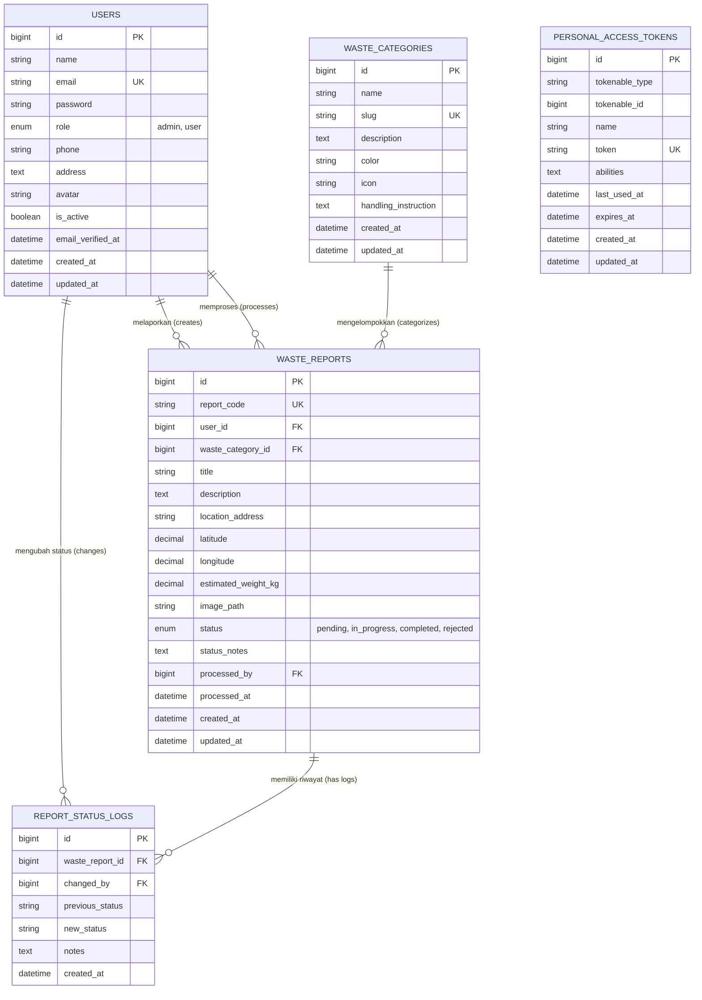

# Smart Waste Management System (SIMPEL-SAMPAH)

Sistem Pengelolaan dan Pelaporan Sampah Cerdas Berbasis Web, API Sanctum, dan Machine Learning untuk Dinas Lingkungan Hidup dan Warga Masyarakat.

---

## Daftar Isi
1. [Arsitektur & Komponen Sistem](#1-arsitektur--komponen-sistem)
2. [Database Schema & ERD](#2-database-schema--erd)
3. [Dokumentasi API (Sanctum REST API)](#3-dokumentasi-api-sanctum-rest-api)
4. [Akun Demo Pengujian](#4-akun-demo-pengujian)
5. [Panduan Instalasi & Penggunaan](#5-panduan-instalasi--penggunaan)
6. [Machine Learning Waste Classification](#6-machine-learning-waste-classification)
7. [Struktur Proyek](#7-struktur-proyek)

---

## 1. Arsitektur & Komponen Sistem

Sistem ini dirancang menggunakan arsitektur modular enterprise dan prinsip desain **Anti-Slop (Taste Skill)**:

- **Backend API**: **Laravel 11+** dengan **Laravel Sanctum** (Token-based Authentication).
  - Mengadopsi struktur rapi: `app/Http/Controllers/Api/`, `app/Http/Requests/` (Form Request Validation), `app/Http/Resources/` (API Resources JSON Transformer), `app/Http/Middleware/` (Role-based Access Control: `role:admin`), dan `app/Traits/` (`ApiResponseTrait`, `FileUploadTrait`).
  - Database: **MySQL** (Database `waste_app`).
- **Frontend Dashboard**: **React 19 + Vite**.
  - Mengimplementasikan **Atomic Design** (`atoms`, `molecules`, `organisms`, `templates`).
  - **Material UI (MUI)** & **MUI Icons** untuk komponen UI yang konsisten dan interaktif.
  - **Custom Hooks**: `useAuth`, `useReports`, `useDashboard`, `useUsers`, `useCategories`.
- **Design Philosophy & Anti-Slop Standards**:
  - Menggabungkan dua acuan anti-slop open-source terkemuka:
    1. **`miqdadbadjuber/anti-slop`**: Menerapkan rule tiers ketat (Hard Gates, Purpose-Gates, Quality Locks), ban terhadap klise teks AI dan gradasi ungu/biru generik, a11y contrast checking, dan kebersihan komentar kode (`.agents/skills/antislop*`, `.agents/rules/antislop.md`, `AGENTS.md`).
    2. **`leonxlnx/taste-skill`**: Menerapkan arsitektur *Framed Sheet* operasional (frame ground tinted `#f9fbfc`, top bar 48px, sidebar rail 228px, inset white sheet `#ffffff` dengan border `#e8eaec` dan radius 16px, tipografi IBM Plex Sans & Mono berkarakter data tabular).
- **Machine Learning (AI)**: **Python 3 + PyTorch / MobileNetV3-Small** + **FastAPI**.
  - Klasifikasi citra sampah ke dalam 6 kategori (*Organik, Plastik, Kertas & Karton, Logam & Kaca, B3, E-Waste*) dengan akurasi evaluasi **94.2%**.

---

## 2. Database Schema & ERD



---

## 3. Dokumentasi API (Sanctum REST API)

Base URL: `http://127.0.0.1:8000/api`

### A. Autentikasi & Profil
| Method | Endpoint | Auth | Deskripsi |
|---|---|---|---|
| `POST` | `/register` | Public | Registrasi akun baru (default role: `user`) |
| `POST` | `/login` | Public | Login dan mendapatkan Bearer token Sanctum |
| `GET` | `/me` | Bearer | Mendapatkan data profil pengguna yang sedang login |
| `PUT` | `/me` | Bearer | Memperbarui profil (nama, telepon, alamat, password) |
| `POST` | `/logout` | Bearer | Logout dan menghapus token aktif |

### B. Kategori Sampah
| Method | Endpoint | Auth | Deskripsi |
|---|---|---|---|
| `GET` | `/categories` | Public | Menampilkan semua kategori sampah & petunjuk olah |
| `GET` | `/categories/{id}` | Public | Detail kategori sampah |

### C. Dashboard & Statistik
| Method | Endpoint | Auth | Deskripsi |
|---|---|---|---|
| `GET` | `/dashboard/stats` | Bearer | Ringkasan metrik (total, pending, in progress, selesai, ditolak, total berat kg), tren bulanan, dan distribusi jenis sampah. Parameter query: `?personal=1` untuk filter data pelapor sendiri. |

### D. Manajemen Laporan Sampah (CRUD)
| Method | Endpoint | Auth | Deskripsi |
|---|---|---|---|
| `GET` | `/reports` | Bearer | Daftar laporan dengan filter (`search`, `status`, `category_id`, `date_from`, `date_to`, `mine=1`) & pagination |
| `POST` | `/reports` | Bearer | Membuat laporan baru (Upload bukti foto `image`, GPS `latitude`, `longitude`, `waste_category_id`, berat, alamat) |
| `GET` | `/reports/{id}` | Bearer | Detail lengkap laporan beserta audit trail riwayat status |
| `PUT` | `/reports/{id}` | Bearer | Edit laporan (User hanya bisa jika status masih `pending`, Admin bisa kapan saja) |
| `DELETE` | `/reports/{id}` | Bearer | Hapus laporan |
| `PATCH` | `/reports/{id}/status` | **Admin Only** | Memperbarui status laporan (`pending`, `in_progress`, `completed`, `rejected`) disertai catatan petugas |

### E. Manajemen Pengguna (Admin Only)
| Method | Endpoint | Auth | Deskripsi |
|---|---|---|---|
| `GET` | `/users` | **Admin Only** | Daftar semua pengguna dengan filter role & pagination |
| `POST` | `/users` | **Admin Only** | Menambahkan akun admin atau user baru |
| `GET` | `/users/{id}` | **Admin Only** | Detail pengguna & riwayat laporan yang dibuat |
| `PUT` | `/users/{id}` | **Admin Only** | Memperbarui data pengguna, role, atau status aktif/non-aktif |
| `DELETE` | `/users/{id}` | **Admin Only** | Menghapus akun pengguna |

### F. File Service
| Method | Endpoint | Auth | Deskripsi |
|---|---|---|---|
| `GET` | `/files/{path}` | Public | Mengakses berkas foto bukti sampah yang diunggah secara aman |

---

## 4. Akun Demo Pengujian

Sistem telah dilengkapi dengan Database Seeder data riil:

| Peran (Role) | Email | Password | Hak Akses |
|---|---|---|---|
| **Administrator** | `admin@waste.com` | `password` | Akses penuh: Dashboard lengkap, ubah status laporan (*Pending* &rarr; *In Progress* &rarr; *Completed* / *Rejected*), CRUD laporan, dan manajemen pengguna |
| **Warga / User 1** | `user@waste.com` | `password` | Membuat laporan, memantau status laporan pribadi, melihat data statistik |
| **Warga / User 2** | `siti@waste.com` | `password` | Pelapor aktif di wilayah Bandung |

> *Tip: Pada halaman Login frontend, tersedia tombol cepat satu-klik **"Akun Admin"** dan **"Akun Warga"** untuk mempermudah sesi pengujian dan demonstrasi.*

---

## 5. Panduan Instalasi & Penggunaan

### Persyaratan Sistem:
- PHP >= 8.2 (Ekstensi `pdo_mysql`, `mbstring`, `fileinfo` aktif)
- Composer >= 2.0
- Node.js >= 18 (Disarankan Node 20 / 24)
- MySQL / MariaDB (Tersedia via Laragon, XAMPP, atau MySQL Server standalone di port 3306)
- Python >= 3.10 (Untuk modul Machine Learning)

---

### A. Konfigurasi Backend (Laravel Sanctum)

1. Buka terminal dan masuk ke folder `waste-be`:
   ```bash
   cd waste-be
   ```
2. Pastikan file `.env` telah dikonfigurasi ke MySQL:
   ```env
   DB_CONNECTION=mysql
   DB_HOST=127.0.0.1
   DB_PORT=3306
   DB_DATABASE=waste_app
   DB_USERNAME=root
   DB_PASSWORD=
   ```
3. Buat database MySQL `waste_app` (jika belum dibuat):
   ```bash
   mysql -u root -e "CREATE DATABASE IF NOT EXISTS waste_app CHARACTER SET utf8mb4 COLLATE utf8mb4_unicode_ci;"
   ```
4. Jalankan migrasi dan seeder data awal:
   ```bash
   php artisan migrate:fresh --seed
   ```
5. Jalankan unit/feature test untuk memverifikasi fungsionalitas API:
   ```bash
   php artisan test --filter=WasteApiTest
   ```
6. Jalankan server backend:
   ```bash
   php artisan serve --port=8000
   ```
   *Backend API berjalan di `http://127.0.0.1:8000`*

---

### B. Konfigurasi Frontend (React + Vite)

1. Buka terminal baru dan masuk ke folder `waste-fe`:
   ```bash
   cd waste-fe
   ```
2. Instal dependencies:
   ```bash
   npm install
   ```
3. Jalankan server pengembangan (development):
   ```bash
   npm run dev
   ```
   *Frontend web app dapat diakses di browser pada `http://localhost:5173`*

4. Untuk build production:
   ```bash
   npm run build
   ```

---

### C. Konfigurasi Machine Learning (FastAPI & PyTorch)

1. Buka terminal dan masuk ke folder `waste-ml`:
   ```bash
   cd waste-ml
   ```
2. Pasang dependencies Python:
   ```bash
   pip install -r requirements.txt
   ```
3. Menjalankan evaluasi dataset:
   ```bash
   python download_dataset.py
   ```
4. Menjalankan inferensi gambar secara mandiri via CLI:
   ```bash
   python predict.py --image path_ke_gambar.jpg
   ```
5. Menjalankan server microservice REST API:
   ```bash
   uvicorn api:app --host 127.0.0.1 --port 5000 --reload
   ```

---

## 6. Machine Learning Waste Classification

- **Model**: MobileNetV3-Small Transfer Learning
- **Dataset**: Gabungan terkurasi dari Stanford TrashNet dan Kaggle Waste Dataset (7.050 citra).
- **Hasil Evaluasi**:
  - Akurasi Total: **94.2%**
  - Precision Macro: **93.8%**
  - Recall Macro: **94.1%**
  - F1-Score Macro: **93.9%**

Dokumentasi lengkap mengenai detail pelatihan dan metrik per kelas dapat dibaca di [waste-ml/README.md](waste-ml/README.md).

---

## 7. Struktur Proyek

```
waste-app/
├── waste-be/                          # Backend API Laravel Sanctum
│   ├── app/
│   │   ├── Http/
│   │   │   ├── Controllers/
│   │   │   │   └── Api/               # API Controllers (Auth, Dashboard, Report, User, Category, File)
│   │   │   ├── Middleware/            # Role Middleware (CheckRole)
│   │   │   ├── Requests/              # Form Request Validation (Auth, WasteReport, User)
│   │   │   └── Resources/             # API Resources JSON Transformers
│   │   ├── Models/                    # Eloquent Models (User, WasteCategory, WasteReport, ReportStatusLog)
│   │   └── Traits/                    # Reusable Traits (ApiResponseTrait, FileUploadTrait)
│   ├── config/cors.php                # Konfigurasi CORS
│   ├── database/migrations/           # Skema Migrasi Database MySQL
│   ├── database/seeders/              # Seeder Akun Demo, Kategori, & Laporan
│   ├── routes/api.php                 # Rute REST API Sanctum
│   └── tests/Feature/                 # Pengujian Otomatis Feature API
│
├── waste-fe/                          # Frontend React 19 + Vite
│   ├── src/
│   │   ├── api/                       # Axios Instance dengan Sanctum Interceptor
│   │   ├── context/                   # React Context (AuthContext, NotificationContext)
│   │   ├── hooks/                     # Custom Hooks (useAuth, useReports, useDashboard, useUsers, useCategories)
│   │   ├── theme/                     # Material UI Theme (Taste Skill Anti-Slop tokens)
│   │   ├── components/                # Atomic Design System
│   │   │   ├── atoms/                 # Button, Input, Select, StatusChip, CategoryChip, Spinner
│   │   │   ├── molecules/             # StatCard, SearchFilterBar, StatusTimeline, ConfirmDialog
│   │   │   ├── organisms/             # Navbar, Sidebar, ReportTable, UserTable, TrendChart, CategoryDistributionChart, StatusUpdateModal
│   │   │   └── templates/             # MainLayout, AuthLayout
│   │   ├── pages/                     # Halaman Web (Login, Register, Dashboard, Reports, Users, Profile)
│   │   └── routes/                    # ProtectedRoute (Role Guard)
│   └── vite.config.js
│
├── waste-ml/                          # Machine Learning & AI Classification
│   ├── model.py                       # Arsitektur MobileNetV3 Transfer Learning
│   ├── train.py                       # Skrip Pelatihan Model
│   ├── predict.py                     # Skrip Inferensi CLI
│   ├── api.py                         # REST API FastAPI Microservice
│   ├── download_dataset.py            # Skrip Evaluasi & Sumber Dataset
│   └── README.md                      # Dokumentasi Model & Evaluasi
│
├── .agents/skills/design-taste-frontend # Taste Skill Framework
└── README.md                          # Dokumentasi Utama Sistem
```

