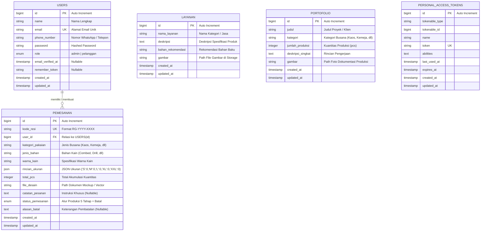

# Entity Relationship Diagram (ERD) & Skema Database
## CV Ristrich Garment - Sistem Informasi & Pemesanan Online Konveksi Busana

Dokumen ini memuat arsitektur basis data relasional untuk sistem pemesanan konveksi CV Ristrich Garment, relasi antar entitas, tipe data kolom, indeks performa, dan integritas referensial.

---

### Visualisasi ERD (Entity-Relationship Diagram)



---

### Rincian Struktur Tabel

#### 1. Tabel `users`
Menyimpan identitas seluruh pengguna sistem, baik pelanggan konveksi maupun administrator workshop.

| Kolom | Tipe Data | Modifiers | Deskripsi |
| :--- | :--- | :--- | :--- |
| `id` | `BIGINT UNSIGNED` | `AUTO_INCREMENT`, `PRIMARY KEY` | Kunci utama pengguna |
| `name` | `VARCHAR(255)` | `NOT NULL` | Nama lengkap pengguna / PIC instansi |
| `email` | `VARCHAR(255)` | `NOT NULL`, `UNIQUE` | Email login resmi |
| `phone_number` | `VARCHAR(30)` | `NOT NULL` | Nomor HP / WhatsApp aktif untuk konfirmasi produksi |
| `password` | `VARCHAR(255)` | `NOT NULL` | Hash password (Bcrypt / Argon2id) |
| `role` | `ENUM('admin','pelanggan')`| `NOT NULL`, `DEFAULT 'pelanggan'` | Hak akses sistem |
| `remember_token` | `VARCHAR(100)` | `NULLABLE` | Sesi token Laravel |
| `created_at` | `TIMESTAMP` | `NULLABLE` | Waktu akun didaftarkan |
| `updated_at` | `TIMESTAMP` | `NULLABLE` | Waktu terakhir pembaruan data |

*Indeks:*
- `PRIMARY KEY (id)`
- `UNIQUE INDEX (email)`
- `INDEX (role)`

---

#### 2. Tabel `layanan`
Menyimpan data katalog jenis layanan konveksi yang ditawarkan oleh CV Ristrich Garment kepada calon klien.

| Kolom | Tipe Data | Modifiers | Deskripsi |
| :--- | :--- | :--- | :--- |
| `id` | `BIGINT UNSIGNED` | `AUTO_INCREMENT`, `PRIMARY KEY` | Kunci utama layanan |
| `nama_layanan` | `VARCHAR(255)` | `NOT NULL` | Nama layanan (Contoh: Kemeja PDH/PDL) |
| `deskripsi` | `TEXT` | `NOT NULL` | Ulasan detail spesifikasi jahitan dan aplikasi |
| `bahan_rekomendasi` | `VARCHAR(255)` | `NOT NULL` | Contoh: American Drill, Nagata Drill, Taipan Drill |
| `gambar` | `VARCHAR(255)` | `NOT NULL` | Nama file gambar di direktori `storage/app/public/layanan` |
| `created_at` | `TIMESTAMP` | `NULLABLE` | Waktu pembuatan |
| `updated_at` | `TIMESTAMP` | `NULLABLE` | Waktu pembaruan |

---

#### 3. Tabel `portofolio`
Menyimpan rekam jejak hasil produksi pesanan yang telah diselesaikan untuk meyakinkan calon konsumen.

| Kolom | Tipe Data | Modifiers | Deskripsi |
| :--- | :--- | :--- | :--- |
| `id` | `BIGINT UNSIGNED` | `AUTO_INCREMENT`, `PRIMARY KEY` | Kunci utama portofolio |
| `judul` | `VARCHAR(255)` | `NOT NULL` | Judul portofolio / nama klien |
| `kategori` | `VARCHAR(100)` | `NOT NULL` | Kategori busana (Kaos, Kemeja, Jaket, Rompi, Jersey) |
| `jumlah_produksi` | `INT UNSIGNED` | `NOT NULL` | Kuantitas pengerjaan (pcs) |
| `deskripsi_singkat` | `TEXT` | `NOT NULL` | Ringkasan pengerjaan bahan, teknik bordir/sablon |
| `gambar` | `VARCHAR(255)` | `NOT NULL` | Nama file gambar foto hasil jadi |
| `created_at` | `TIMESTAMP` | `NULLABLE` | Waktu publikasi portofolio |
| `updated_at` | `TIMESTAMP` | `NULLABLE` | Waktu pembaruan |

*Indeks:*
- `INDEX (kategori)`

---

#### 4. Tabel `pemesanan`
Tabel sentral operasional yang mencatat setiap pemesanan jahit busana, spesifikasi bahan, ukuran bertingkat, dan pelacakan status produksi secara real-time.

| Kolom | Tipe Data | Modifiers | Deskripsi |
| :--- | :--- | :--- | :--- |
| `id` | `BIGINT UNSIGNED` | `AUTO_INCREMENT`, `PRIMARY KEY` | Kunci utama pesanan |
| `kode_resi` | `VARCHAR(20)` | `NOT NULL`, `UNIQUE` | Kode unik pelacakan (Contoh: `RG-2026-1049`) |
| `user_id` | `BIGINT UNSIGNED` | `NOT NULL` | Relasi ke `users.id` (Foreign Key `ON DELETE CASCADE`) |
| `kategori_pakaian` | `VARCHAR(100)` | `NOT NULL` | Kategori busana |
| `jenis_bahan` | `VARCHAR(100)` | `NOT NULL` | Jenis bahan pilihan konsumen |
| `warna_kain` | `VARCHAR(100)` | `NOT NULL` | Pilihan warna kain busana |
| `rincian_ukuran` | `JSON` | `NOT NULL` | Pemetaan ukuran: `{"S": 10, "M": 20, "L": 30, "XL": 10, "XXL": 5}` |
| `total_pcs` | `INT UNSIGNED` | `NOT NULL` | Akumulasi total kuantitas seluruh ukuran |
| `file_desain` | `VARCHAR(255)` | `NOT NULL` | Path berkas desain mockup / sketsa (JPG, PNG, PDF, ZIP) |
| `catatan_pesanan` | `TEXT` | `NULLABLE` | Instruksi tambahan, detail letak bordir/sablon |
| `status_pemesanan` | `ENUM` | `NOT NULL`, `DEFAULT 'Pesanan Diterima'` | Nilai yang diizinkan (lihat aturan bisnis di bawah) |
| `alasan_batal` | `TEXT` | `NULLABLE` | Alasan pembatalan (wajib jika status `'Dibatalkan'`) |
| `created_at` | `TIMESTAMP` | `NULLABLE` | Waktu pemesanan masuk |
| `updated_at` | `TIMESTAMP` | `NULLABLE` | Waktu perubahan terakhir / pergeseran status |

*Indeks:*
- `PRIMARY KEY (id)`
- `UNIQUE INDEX (kode_resi)`
- `INDEX (user_id)`
- `INDEX (status_pemesanan)`
- `INDEX (created_at)`

---

### Aturan Bisnis & State Machine Status Pemesanan

Alur pergerakan status produksi busana di CV Ristrich Garment:

```
[Pesanan Diterima] ──> [Antrean Produksi] ──> [Sedang Dipotong & Dijahit] ──> [QC & Finishing] ──> [Selesai]
         │                     │                              │                        │
         └─────────────────────┴──────────────────────────────┴────────────────────────┴───> [Dibatalkan]
```

1. **Pesanan Diterima**: Pesanan baru masuk dari formulir online pelanggan, file desain dan spesifikasi menunggu review antrean oleh bagian pola.
2. **Antrean Produksi**: Desain telah disetujui, bahan kain telah dialokasikan dari gudang/supplier konveksi.
3. **Sedang Dipotong & Dijahit**: Kain sedang dipotong (cutting), disablon/dibordir komputer, dan masuk jalur perakitan jahit oleh operator mesin.
4. **QC & Finishing**: Busana telah dirakit, masuk proses pembersihan sisa benang, steam/setrika uap, pengecekan ukuran (Quality Control), dan packing plastik.
5. **Selesai**: Pesanan telah selesai 100% dan siap diambil di workshop atau dikirim via ekspedisi.
6. **Dibatalkan**: Kondisi khusus jika bahan kosong atau terdapat pembatalan resmi. Membutuhkan field `alasan_batal`.

